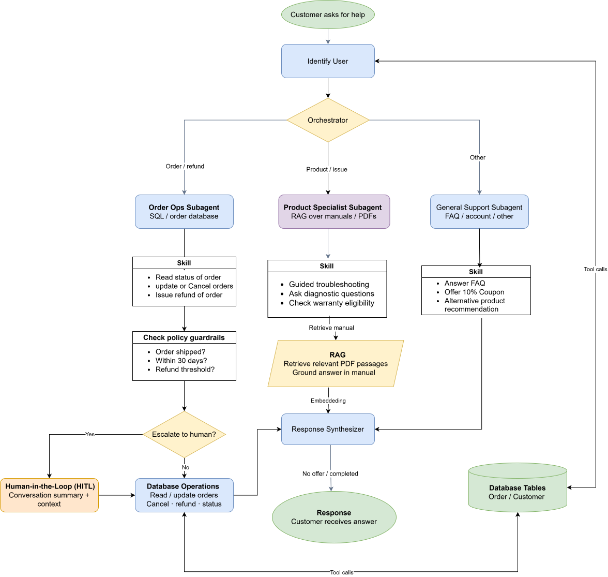
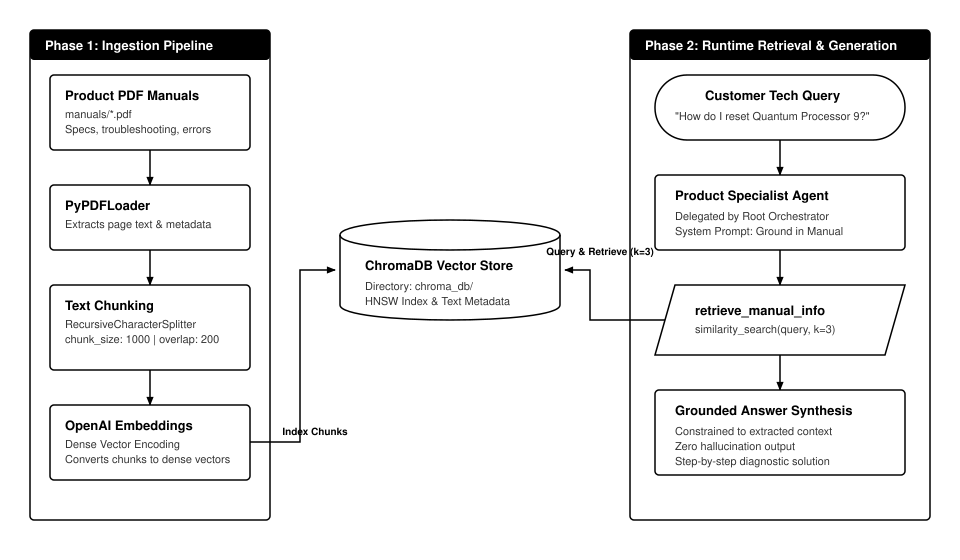
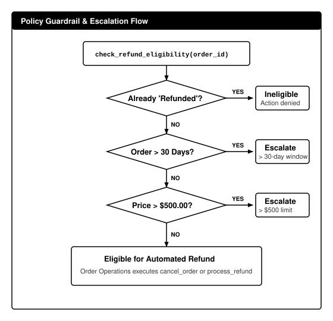
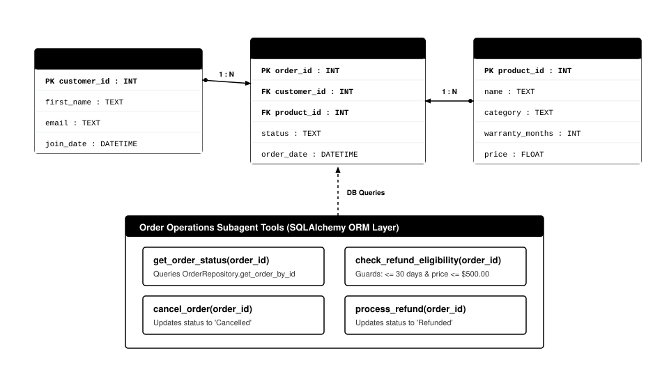

# Multi-Agent Enterprise Customer Helpdesk

An enterprise multi-agent customer support system built with DeepAgents, LangChain, LangGraph, LangSmith, and ChromaDB. It features supervisor orchestration, domain-specialized subagents, RAG over PDF technical manuals, SQL database tools, and policy guardrails with Human-in-the-Loop (HITL) escalation.

---

## Table of Contents

- [Technology Stack](#technology-stack)
- [System Architecture](#system-architecture)
- [RAG Pipeline](#rag-pipeline)
- [Tools and Guardrails](#tools-and-guardrails)
- [Database Schema](#database-schema)
- [Example Queries](#example-queries)

---

## Technology Stack

- **DeepAgents**: Multi-agent orchestration and subagent routing.
- **LangChain**: Tool definitions (`@tool`), PDF parsing, and text splitting.
- **LangGraph**: Agent state graph coordination and thread memory (`MemorySaver`).
- **LangSmith**: Execution tracing and observability.
- **ChromaDB**: Persistent vector database for RAG embeddings.
- **SQLite / SQLAlchemy**: Relational order database and ORM operations.

---

## System Architecture

Incoming customer requests enter a root **Customer Support Orchestrator** that classifies intent and delegates execution to a specialized subagent.

<p align="center">
  
</p>

### Routing Logic

- **Order Operations (`order-ops`)**: Order status queries, cancellations, and refund requests.
- **Product Specialist (`product-specialist`)**: Hardware troubleshooting, error codes, and specs using RAG over product manuals.
- **General Support (`general-support`)**: Account questions, FAQ, navigation, and customer satisfaction discounts.

---

## RAG Pipeline

Technical support answers are strictly grounded in product PDF manuals to prevent hallucinations.

<p align="center">
  
</p>

---

## Tools and Guardrails

Below is the deterministic policy evaluation flowchart for automated cancellations and refunds:

<p align="center">
  
</p>

### Tool Reference

| Tool | Subagent | Data Store | Function |
| :--- | :--- | :--- | :--- |
| `retrieve_manual_info` | `product-specialist` | ChromaDB | Semantic search (`k=3`) across embedded PDF manuals. |
| `get_order_status` | `order-ops` | SQLite | Returns order state (`Shipped`, `Pending`, `Cancelled`, `Refunded`). |
| `cancel_order` | `order-ops` | SQLite | Updates order status to `Cancelled`. |
| `process_refund` | `order-ops` | SQLite | Updates order status to `Refunded`. |
| `check_refund_eligibility` | `order-ops` | SQLite | Evaluates return window and price guardrails. |

---

## Database Schema

Relational data stored in SQLite (`orders.db`) managed via SQLAlchemy models in `database/models.py`.

<p align="center">
  
</p>

---

## Example Queries

### 1. RAG Technical Troubleshooting
```plaintext
Customer: My Quantum Processor 9 has an amber status light. How do I fix it?
Agent: According to the manual, amber indicates a thermal synchronization lockout.
1. Power down host system.
2. Hold rear diagnostic button for 10 seconds.
3. Wait 2 minutes for cryo-coolant equalization before rebooting.
```

### 2. Automated Cancellation (Eligible)
```plaintext
Customer: Cancel order #2.
Agent: Order #2 is Pending and within the 30-day policy window. It has been cancelled successfully.
```

### 3. Human Escalation (Price Threshold Exceeded)
```plaintext
Customer: I want a refund for order #9.
Agent: Order #9 (Gravity Glove, $850.00) exceeds our automated $500.00 threshold. I have escalated your request to a human support specialist with your order details.
```

### 4. General Support & Appeasement
```plaintext
Customer: I had trouble finding product specs on your website.
Agent: I apologize for the difficulty. Please use promo code DISCOUNT10 for 10% off your next purchase. How else may I assist you?
```
